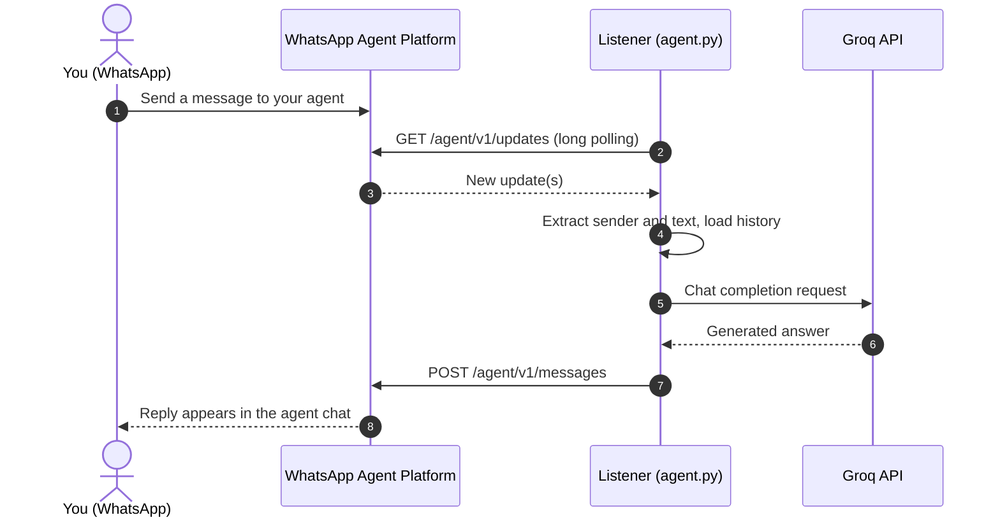

<div align="center">

# WhatsApp Agent Listener

**A lightweight Python listener that connects the WhatsApp Third-Party Agent Platform to Groq AI.**


[Quick Start](#quick-start) · [How It Works](#how-it-works) · [Configuration](#configuration) · [Troubleshooting](#troubleshooting) · [Roadmap](#roadmap)

</div>

---

## Overview

WhatsApp Agent Listener receives messages sent to your WhatsApp agent, generates a reply with a [Groq](https://groq.com) model, and sends that reply back through the WhatsApp Agent Platform API.

It is built as a clean, minimal foundation for developers who want to create their own WhatsApp AI agents, with a longer-term goal of supporting plugins and additional AI providers.

> [!NOTE]
> This project uses the platform's **long-polling `/updates` endpoint**. It does **not** run an incoming HTTP webhook server and does **not** require a public URL or tunnel.

## Features

- **Long polling** – no public endpoint, port forwarding, or tunnel required.
- **Groq-powered replies** – choose any available Groq model via an environment variable.
- **Per-sender conversation context** – recent history is kept in memory for each sender.
- **Durable polling state** – update offsets and processed message IDs are stored in a local JSON file.
- **Read receipts and typing indicator** – attempted for supported incoming messages.
- **Resilient by default** – exponential backoff after failures, with major events and errors logged to the terminal.
- **Modern tooling** – Python versions, dependencies, and the environment are managed with [`uv`](https://docs.astral.sh/uv/).

## How It Works



The Python process makes **outbound** requests only. The listener must stay running to reply; when it stops, no updates are processed.

## Quick Start

### Prerequisites

| Requirement | Notes |
|---|---|
| [`uv`](https://docs.astral.sh/uv/getting-started/installation/) | Manages Python, dependencies, and the virtual environment. |
| Python 3.14 | Requested by `.python-version` and `pyproject.toml`; `uv` can install it for you. |
| WhatsApp Third-Party Agent + API token | Found in your agent's API-key settings. |
| Groq account + API key | Create one at [console.groq.com/keys](https://console.groq.com/keys). |
| Internet access | Required for both APIs. |

### 1. Install `uv`

<details>
<summary><strong>Windows (PowerShell)</strong></summary>

```powershell
powershell -ExecutionPolicy ByPass -c "irm https://astral.sh/uv/install.ps1 | iex"
```

If you use Command Prompt, run the command above from PowerShell once, then return to CMD.

</details>

<details>
<summary><strong>Linux / macOS</strong></summary>

```bash
curl -LsSf https://astral.sh/uv/install.sh | sh
```

</details>

Open a new terminal and verify:

```bash
uv --version
```

### 2. Clone the repository

```bash
git clone https://github.com/Saif-Ali-109/whatsapp-agent-listener.git
cd whatsapp-agent-listener
```

Run all remaining commands from the repository root (the directory containing `pyproject.toml`, `uv.lock`, and `agent.py`).

### 3. Install Python and dependencies

```bash
uv python install 3.14   # only if Python 3.14 is not already available
uv sync
```

`uv sync` creates `.venv/` and installs the locked dependencies from `uv.lock`. Verify the interpreter with:

```bash
uv run python --version
```

> [!TIP]
> Activating the virtual environment is optional. `uv run` always executes inside the project environment.
> To activate manually: `source .venv/bin/activate` (Linux/macOS), `.\.venv\Scripts\Activate.ps1` (PowerShell), or `.venv\Scripts\activate.bat` (CMD).
> If PowerShell blocks activation, use `uv run` instead of changing system-wide execution policies.

### 4. Configure credentials

Copy the example environment file:

```bash
# Linux / macOS
cp .env.example .env
```

```powershell
# Windows PowerShell
Copy-Item .env.example .env
```

```bat
:: Windows CMD
copy .env.example .env
```

Then edit `.env`:

```dotenv
WHATSAPP_AGENT_TOKEN=your_whatsapp_agent_token
GROQ_API_KEY=your_groq_api_key
GROQ_MODEL=openai/gpt-oss-20b
```

### 5. Run the listener

```bash
uv run agent.py
```

Startup logs show the selected model and API endpoint. Keep the terminal open while you want the agent to respond, and stop it with **Ctrl+C**.

### Example

```text
You:   My name is Saif.
Agent: Nice to meet you, Saif! How can I help you today?

You:   What's my name?
Agent: Your name is Saif.
```

The agent can answer the second question because recent messages are included in the model context. This memory lives in RAM and is cleared when the program restarts.

## Configuration

| Variable | Required | Default | Description |
|---|:---:|---|---|
| `WHATSAPP_AGENT_TOKEN` | Yes | – | Authorizes requests to the WhatsApp Agent Platform API. |
| `GROQ_API_KEY` | Yes | – | Authorizes requests to the Groq API. |
| `GROQ_MODEL` | No | `openai/gpt-oss-20b` | Groq model used to generate replies. |

Groq model availability can change. If the default is unavailable to your account, set `GROQ_MODEL` to a model listed in your Groq console or in the [Groq documentation](https://console.groq.com/docs).

## Project Structure

```text
whatsapp-agent-listener/
├── agent.py                 # Polling loop, WhatsApp API calls, Groq responses
├── src/
│   └── whatsapp_agent/
│       └── __init__.py      # Package initialization
├── pyproject.toml           # Project metadata and dependencies
├── uv.lock                  # Locked dependency versions
├── .python-version          # Requested Python version (3.14)
├── .env.example             # Template with placeholder credentials
├── .env                     # Local secrets (create locally, never commit)
├── agent_state.json         # Runtime state (generated, not tracked)
└── README.md
```

## Message Handling

| Topic | Behavior |
|---|---|
| **Text messages** | Sent to Groq with the system prompt and the sender's recent history; the answer is returned to the sender identifier from the update payload. |
| **Other message types** | A fallback reply asks the user to send text. Image, audio, video, document, and sticker understanding is not implemented. |
| **Reactions** | Ignored. |
| **Old messages** | Messages timestamped before the process started are skipped. |
| **Duplicates** | Offsets and processed message IDs are persisted in `agent_state.json` to avoid reprocessing. This is **not** an exactly-once guarantee; in some network failures a reply may be sent twice. |
| **Memory** | Conversation history is in RAM only and is cleared on restart. Polling state persists on disk. |

## Limitations

- Transport is long polling, not an incoming HTTP webhook.
- Designed for the agent creator's permitted conversation. It cannot be added to arbitrary personal chats or WhatsApp groups; the platform's API and recipient restrictions apply.
- Groq is the only supported AI provider.
- Text is the only fully supported input type.
- Conversation memory is not persisted across restarts.
- State is stored in a local JSON file.
- There is no stable plugin API or hosted dashboard yet.
- Additional reliability and security hardening is needed before use as a production multi-user service.

## Troubleshooting

<details>
<summary><strong><code>uv</code> is not recognized</strong></summary>

Open a new terminal after installing. If it still isn't found, follow the [official installation guide](https://docs.astral.sh/uv/getting-started/installation/).

</details>

<details>
<summary><strong>Python version or installation error</strong></summary>

```bash
uv python install 3.14
uv python list
uv venv --python 3.14
uv sync
```

</details>

<details>
<summary><strong>Missing environment variable</strong></summary>

Confirm `.env` exists in the project root and contains `WHATSAPP_AGENT_TOKEN` and `GROQ_API_KEY`, with no stray spaces around names and valid values.

</details>

<details>
<summary><strong>WhatsApp authentication or recipient error</strong></summary>

Verify the agent token and make sure the agent and recipient are permitted by the platform. Use the sender identifier from the incoming payload; do not substitute an ordinary phone number unless the API explicitly requires it.

</details>

<details>
<summary><strong>Groq authentication or model error</strong></summary>

Verify your key at [console.groq.com/keys](https://console.groq.com/keys) and confirm `GROQ_MODEL` is available to your account. Never share API keys in issues or screenshots.

</details>

<details>
<summary><strong>No reply arrives</strong></summary>

1. Confirm `uv run agent.py` is still running.
2. Check the terminal logs for HTTP or Groq errors.
3. Make sure you are messaging the dedicated agent chat supported by the platform.
4. Send a plain text message.
5. Check API availability, credentials, and rate limits.

</details>

<details>
<summary><strong>Rate limit errors</strong></summary>

Some endpoints limit polling and sending frequency. Run only one listener per agent, and if limits persist, stop retrying and review the platform's limits and error response.

</details>

## Security

- Never commit `.env`, API tokens, or private conversation data. `.env.example` must contain placeholders only.
- Keep `agent_state.json` out of version control; it may contain identifiers or operational state.
- Message content is sent to Groq, an external AI provider. Disclose this to anyone who uses your agent.
- If a real token or key was ever pushed to a public repository, **revoke and rotate it**. Deleting the file in a later commit does not remove it from Git history.
- Before hosting for multiple customers, add credential protection, tenant isolation, data-retention controls, monitoring, and more testing.

## Roadmap

Planned work, not yet implemented:

- [ ] Split transport, message dispatch, AI generation, and state management into modules
- [ ] Add tests for update parsing, retries, and message processing
- [ ] Define a stable event-handler and plugin interface
- [ ] Introduce a common interface for AI providers
- [ ] Add providers beyond Groq
- [ ] Add persistent conversation storage with configurable retention
- [ ] Add structured logging, health checks, and graceful shutdown
- [ ] Document deployment and production security
- [ ] Explore an optional hosted dashboard

## Contributing

Contributions, bug reports, documentation improvements, and feature ideas are welcome.

1. Fork the repository.
2. Create a feature branch: `git checkout -b feature/my-improvement`
3. Make and test your changes.
4. Commit with a clear message: `git commit -m "feat: describe the improvement"`
5. Push and open a pull request describing the problem and your solution.

For major changes, especially to the plugin API or storage design, please open an issue first to discuss the approach.

## License

This project is licensed under the [MIT License](LICENSE).

## Disclaimer

This is an independent community project. It is not affiliated with, endorsed by, or officially supported by WhatsApp, Meta, or Groq. Product and company names are used only to identify the relevant services. You are responsible for complying with applicable platform terms, privacy requirements, and laws.

## Links

- [Repository](https://github.com/Saif-Ali-109/whatsapp-agent-listener)
- [uv installation](https://docs.astral.sh/uv/getting-started/installation/) · [uv project guide](https://docs.astral.sh/uv/guides/projects/)
- [Groq Console](https://console.groq.com/keys) · [Groq API docs](https://console.groq.com/docs)
